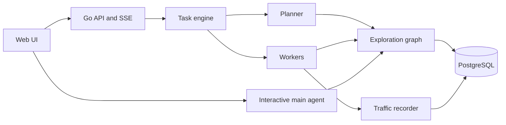

<div align="center">


# AntiFox

**Evidence-focused AI security testing and reporting platform**

Plan work, preserve observations, review findings, and produce structured reports from one self-hosted application.

[](LICENSE)
[](https://github.com/ChathurangaBW/antifox/releases/latest)
[](https://github.com/ChathurangaBW/antifox)
[](https://github.com/ChathurangaBW/antifox/pkgs/container/antifox)


</div>

## What it provides

AntiFox is a self-hosted Go and PostgreSQL application for organizing **authorized** security-assessment work. Its task engine keeps a shared asset inventory and a per-task exploration graph so work, observations, evidence, and findings remain connected.

- **Task orchestration** — planner, workers, and an interactive main-agent session coordinate task-scoped work.
- **Asset and evidence management** — collect assets, inspect recorded traffic, and keep facts and findings linked to the work that produced them.
- **Finding workflow** — retain structured reproduction details, traffic references, severity, remediation notes, and verification status.
- **Reports** — produce DOCX reports with selectable findings and organization/report-template settings.
- **Operations controls** — RBAC, audit records, configurable intercept rules, and a first-run setup token.

> Use AntiFox only on systems you own or are explicitly authorized to assess. Review generated results and reports before relying on them.

## Quick start with Docker

Docker Compose starts AntiFox and PostgreSQL with persistent local data.

```bash
git clone https://github.com/ChathurangaBW/antifox.git
cd antifox
cp .env.example .env
# Edit .env and set a strong POSTGRES_PASSWORD.
docker compose up -d
```

Open [http://localhost:8787](http://localhost:8787).

On the first start, open `/setup` and enter the setup token from the service log:

```bash
docker compose logs antifox | grep "Setup token"
```

The LLM settings may be supplied with environment variables in `.env` or configured in the application. See [`.env.example`](.env.example) for supported variables.

### Update a Docker deployment

Review the release notes and back up your database before upgrades. Then pull and recreate the services:

```bash
docker compose pull
docker compose up -d
```

The Compose file uses `pgvector/pgvector:pg16`. If upgrading an existing volume from the earlier Alpine PostgreSQL image, follow the migration note in [`docker-compose.yml`](docker-compose.yml), including the required index maintenance.

## Other installation options

### Prebuilt binaries

Download an archive for your platform from [GitHub Releases](https://github.com/ChathurangaBW/antifox/releases/latest). Copy `config.example.json` to `config.json`, configure PostgreSQL, then run `antifox` (or `antifox.exe` on Windows).

```bash
cp config.example.json config.json
./antifox
```

### Build from source

Requirements:

- Go **1.26+**
- Node.js **20+**
- PostgreSQL
- Python 3 with `python-docx` for DOCX rendering

```bash
cd web
npm ci
NEXT_EXPORT=1 npm run build
cd ..

mkdir -p server/webui/dist server/skillsdist
cp -r web/out/. server/webui/dist/
cp -r skills/. server/skillsdist/
rm -rf server/skillsdist/report-generation

CGO_ENABLED=0 go build -tags embedui -o antifox ./cmd/antifox
./antifox
```

For development workflow and contribution guidance, read [CONTRIBUTING.md](CONTRIBUTING.md).

## Architecture



- The **asset graph** is a shared inventory across tasks.
- The **exploration graph** records each task's goals, intents, facts, findings, and their relationships.
- Recorded traffic and structured reproduction details provide supporting context for finding review and reporting.

## Screens

| Dashboard | Tasks |
| :---: | :---: |
|  |  |

## Project links

- Source, issues, and releases: [github.com/ChathurangaBW/antifox](https://github.com/ChathurangaBW/antifox)
- Container package: [ghcr.io/chathurangabw/antifox](https://github.com/ChathurangaBW/antifox/pkgs/container/antifox)
- Changelog: [CHANGELOG.md](CHANGELOG.md)
- License: [AGPL-3.0](LICENSE)

## Lineage and license

AntiFox began as a fork of ARTEX v0.1.1. Credit to [@Autumn-27](https://github.com/Autumn-27) and ARTEX for the original foundation. This project is distributed under the [GNU Affero General Public License v3.0](LICENSE); use, modification, and network deployment must comply with that license.

## Responsible use

AntiFox is provided **as is**, without warranty. You are responsible for obtaining permission, defining scope, protecting collected data, and complying with applicable law. Do not use it to access, disrupt, or test systems without authorization.
