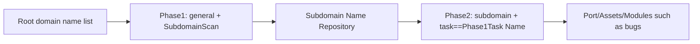

---

## name: scopesentry-mcp
Discretion: Manages secure scanning platforms (projects, tasks, templates, assets, nodes) through ScopeSentry MCP. Used when the user refers to ScopeSentry, MCP, API Key, scanning tasks, asset queries.

# ScopeSentry MCP Use Guide

**for users with deployed ScopeSentry instance**. Connects the platform through Cursor (or other MCP client) without local source code.

## 1. Preparatory work

### 1.1 Confirm service accessible

- Default Web interface: `http://<host>`
- MCP endpoint: `http://<host>/mcp` (if there is a reverse proxy or a front-end proxy, use the actual `/mcp` address)

### 1.2 Create API Key

1. Browser login ScopeSentry Web interface
2. Enter **zz-Key**management page to create key (or create it through an interface provided by the administrator)
3. Save returned `ssk_...` string (**only shows once**)

### 1.3 Configuration Cursor MCP

Cursor — Settings — MCP — Add server:

```json
{
  "mcpServers": {
    "scopesentry": {
      "url": "http://<Your machine.>:8082/mcp",
      "headers": {
        "X-API-Key": "ssk_Your key."
      }
    }
  }
}
```

It may also be used: `Authorization: Bearer ssk_<your-key>`

Reboot MCP or reload Cursor after configuration is complete, confirming the presence of `list_projects`, `list_assets`, etc. in the list of tools.

---

## 2. Tool Overview


| Tools | Use |
| ---------------------- | ----------------- |
| `list_projects` | Items tree by label (including item ID) |
| `list_projects_data` | Page-by-page list of items, searchable by name |
| `get_project` | Project details |
| `create_project` | New Item |
| `list_tasks` | List the scan tasks |
| `get_task` | Mission details |
| `list_scan_templates` | Scan Template List |
| `get_scan_template` | Template Details |
| `list_plugin_modules` | Scan the current waterline module name |
| `list_plugins` | Available plugins (including hash, default parameters) |
| `create_scan_template` | Create Scan Template |
| `create_scan_task` | Create Scan Tasks |
| `list_assets` | Query for all types of assets (page-by-page list) |
| `count_assets` | Quantities of statistical assets (`/api/assets/common/total`) |
| `get_asset_detail` | Details of assets or vulnerabilities |
| `add_asset_tag` | Adding a label to an asset |
| `list_nodes` | Scan Node List |


The tool parameters are based on the MCP tool description (schema); `list_assets`/ `count_assets`'s syntax for search, filter is consistent, and `list_assets` description can be read before searching for the asset.

You need to know how many `count_assets`es are used for the "total number" (comparable to the Web total number of pages) and do not have to repeat the page to count the total number of `list_assets`.

---

## 3. Common workflow

### 3.1 Asset by project

When the user or context **has project conditions**, give priority to `filter.project` to narrow the range so that too much cross-project data does not slow the response. If there are no specified items, project screening is not mandatory.

1. `list_projects` or `list_projects_data` to target item **ObjectID**(`id` / `children[].value`)
2. `list_assets` to `filter.project` (**must be ID and cannot write the Chinese name of the item**)

```json
{
  "asset_type": "asset",
  "pageIndex": 1,
  "pageSize": 20,
  "search": "domain=^example.com",
  "filter": {
    "project": ["<ProjectObjectID>"]
  }
}
```

### 3.2 Create Scan Tasks

1. `list_nodes` Retrieve online node names
2. `list_scan_templates` or `create_scan_template` fetch template **ObjectID**
3. `create_scan_task`:`name`, `node` to fill in, `template` to fill in template ID (not able to fill template name)

**Target source `targetSource` (consistent with Web end):**

| targetSource | Description | Required Parameters |
| --- | --- | --- |
| `general` | Enter the target directly | `target` |
| `project` | Read Target From Project | `project` (project ObjectID array) |
| `asset` | Search from Web Repository | `search`; optional `project`, `filter`, `targetNumber` |
| `RootDomain` | Search from root domain repository | `search`; optional `project`, `filter`, `targetNumber` |
| `subdomain` | Search from the subdomain repository | `search`; optional `project`, `filter`, `targetNumber` |
| `UrlScan` | Search from URL scan results | `search`; optional `project`, `filter`, `targetNumber` |
| `*Source` (e.g. `subdomainSource`) | Create from Asset Page Selection/Scanter | `targetTp=search` for `search`; `targetTp=select` for `targetIds` |

**Example - Direct root-scan domain name:**

```json
{
  "name": "example-Subdomain Name Collection",
  "node": ["node-1"],
  "template": "<TemplatesObjectID>",
  "targetSource": "general",
  "target": "example.com\nfoo.com",
  "project": ["<ProjectObjectID>"]
}
```

**Example - Refurbishment from subdomain name library (screened by previous task name):**

```json
{
  "name": "example-Ports and holes",
  "node": ["node-1"],
  "template": "<Next Module TemplateObjectID>",
  "targetSource": "subdomain",
  "search": "task==\"example-Subdomain Name Collection\"",
  "project": ["<ProjectObjectID>"]
}
```

### 3.3 Complete collection of root domain names (recommends two phases)

When the input is a **root domain** and a **complete information collection** is required, run two scans rather than the complete pipeline at once.

**Why:** Distributed tasks are assigned per **individual target**. When a root domain is assigned to one node, every subdomain it discovers continues through the later modules on that same node. This can create uneven load, slow execution, and errors.

**Best practice:**

1. **Phase 1 — collect subdomains only**
   - `targetSource`: `general`
   - `target`: All root domain names (multiline)
   - Template: only `SubdomainScan`, `SubdomainSecurity` is enabled (subdomain name scan + subdomain name takes over)
   - Use `get_task` to wait for the task to be completed

2. **Phase II - follow-up module**
   - `targetSource`: `subdomain`
   -    - `search`: `task=="<first-phase task name>"` (exact matching task name)
   - Optional `project` narrows the range
   - Template: Port scanning, asset mapping, bug scanning, etc. (not including SubdomainScan)
   - Subdomain names distributed as stand-alone targets to nodes, more efficient in parallel

You can also use " Create jobs from subdomain names ", with the same effect, after the Web interface " Subdomain Name " asset page is filtered by the task name.



### 3.4 Create Scan Template

1. `list_plugin_modules` → Module Name List
2. `list_plugins` (press `module` filter) Plugins `hash` with default `parameter`
3. `create_scan_template`: Use `modules` to specify "modules plugins haveh arrays"

---

## 4. Asset queries (`list_assets` / `count_assets`)

`count_assets` and `list_assets` use the same `asset_type`, `search`, `filter`, returns `{ "total": N }`, corresponding to Webend `/api/assets/common/total`.

```json
{
  "asset_type": "subdomain",
  "search": "task==\"Task Name\"",
  "filter": {"project": ["<ProjectObjectID>"]}
}
```

**Performance recommendation (`list_assets`/ `count_assets` general):**Preference for `filter.project` reduction when project conditions exist; indexed fields in `search` match as much as possible with `==` full or `^` prefix (see [4.3] (#43-search-search expression) and avoid large area `=` vague query slow response. Project screening is not mandatory without the project context.

The type of support for `filter.project` can be found in the [4.4] (#44-filter-exact filter) table.

### 4.1 Asset type `asset_type`

`asset`、`RootDomain`、`subdomain`、`app`、`mp`、`UrlScan`、`SensitiveResult`、`DirScanResult`、`crawler`、`vulnerability`、`PageMonitoring`、`IPAsset`、`SubdomainTakerResult`

Examples of aliases: `web`asset, `vuln`vulnerabilty, `ip`0zz, `url`1zz

### 4.2 Description of parameters


| Parameter | Description |
| ------------------------ | --------------------------------------- |
| `pageIndex` / `pageSize` | Page Break, Default 1/20 |
| `search` | Search expression (see next section) |
| `filter` | Precise filter JSON (see next section) |
| `sort` | Only UrlScan, DirScanResult supports the sorting of `length` |
| `sid` | Only SensitiveResult: Name of sensitive rule |


`search` and `filter` **may be used simultaneously**.

### 4.3 search Search Expression

Custom DSL (**not SQL**):


| Operator | Meaning | Index | Example |
| ---- | ---- | ---- | --------------------------- |
| `=` | Fuzzy Match (regex) | No index. | `domain=example` |
| `==` | Accurate Matching (All Levels) | **Uses an Index** | `port==443` |
| `!=` | Exclude | — | `port!="80"` |
| `&&` | and | — | `domain==example.com && port==443` |
| `||` | or | — | `title=admin || body=login` |


**Indexes and operators:** `domain`, `ip`, `port`, and `title` are indexed, but only **exact `==` matches** or **prefix matches whose value starts with `^`** (for example `domain=^example.com`) use the index. `=` performs a regex fuzzy match and cannot use the index, so it can be slow on large datasets.

**Common `search` fields for all types:** `tag`, `task` (task name), and `rootDomain`.

**Do not put `project` in `search`**; it is invalid or fails when combined with `&&`. Use `filter.project` to restrict projects.

**Common `search` fields by type:**


| asset_type | Fields |
| -------------------- | ----------------------------------------------------------------------------------- |
| asset | domain, ip, port, service, app, title, statuscode, icon, banner, type, body, header |
| RootDomain | domain, icp, company |
| subdomain | domain, ip, type, value |
| app | name, icp, company, category, description, url, apk |
| mp | name, icp, company, category, description, url |
| UrlScan | url, input, source, resultId, type |
| SensitiveResult | url, sname, body, info, md5 |
| DirScanResult | url, statuscode, redirect, length |
| vulnerability | url, vulname, matched, request, response, level |
| crawler | url, method, body, resultId |
| PageMonitoring | url, hash, diff, response |
| IPAsset | ip, domain, port, service, webServer, app |
| SubdomainTakerResult | domain, value, type, response |


**Search Example:**

- `domain==www.example.com && port==443` (full, index)
- `domain=^example.com` (prefix matching, indexing)
- `ip==192.168.1.1`
- `task=="<task name>"`
- `level==high` (vulnerability)
- `statuscode==200` (DirScanResult)

Use `=`, e.g. `title=admin` (without indexing, it is appropriate to reduce the scope of the item, etc.) when the inclusion is vague.

### 4.4 filter Exact Filter

JSON object:**OR**, different Key **AND**for more than one value than Key.

**Preference is given to `project`:**if the user or context has specified the item and asset_type supports `project`, it should be brought with a view to narrowing the scope; no project information is required.


| filter key | Meaning | Value-forward description |
| ------------ | -------- | -------------------------------------------------------- |
| `project` | Items to which | **ObjectID**, fetched with `list_projects`/ `list_projects_data` |
| `task` | Source task | **Job name**, `list_tasks` with `name` |
| `port` | Port | Like `"443"` |
| `service` | Services/agreements | Like `"https"` |
| `app` | Apply Fingerprints | Like `"Nginx"` |
| `icon` | Icon hash | |
| `statuscode` | HTTP Status Code | Mainly for use asset |
| `status` | Status | UrlScan/DirScan HTTP code; leaks/sensitive information processing status |
| `level` | Gap Level | critical / high / medium / low / info |
| `type` | Type | e.g., subdomain name recording type A, CNAME |
| `color` | Sensitive rule color | SensitiveResult |
| `sname` | Sensitive rule name | SensitiveResult |
| `tags` | Label | |


**The types are available from filter key:**


| asset_type | filter key |
| ------------------------------------- | --------------------------------------------------------------- |
| asset | project, port, service, app, icon, statuscode, type, task, tags |
| RootDomain | project, tags |
| subdomain | project, type, task, tags |
| app / mp | project, tags |
| UrlScan | status, tags |
| DirScanResult | status, tags |
| SensitiveResult | status, color, sname, tags |
| crawler | project, task, tags |
| vulnerability | project, level, status, task, tags |
| PageMonitoring / SubdomainTakerResult | tags |
| IPAsset | project, port, service, app |


**Filter Example:**

```json
{"project": ["<ProjectObjectID>"], "port": ["443"]}
```

**Examples of group queries:**

```json
{
  "asset_type": "asset",
  "search": "domain=^baidu && port==443",
  "filter": {"project": ["<ProjectObjectID>"]},
  "pageIndex": 1,
  "pageSize": 10
}
```

**Note:**

- Preference `filter.project` when project conditions are in place; no project context is not mandatory
- `filter.project` Show name of non-filled items
- Known value `==`, prefix `^`; avoid misuse of `=` Fuzzy Matches for large tables
- HTTP status of UrlScan for `filter.status`; DirScanResult for `statuscode==200` in search
- - SensitiveResult Rule name: `search` with `sname=<rule-name>`, or `filter.sname`

### 4.5 Sort sort

**UrlScan**,**DirScanResult**Support:

```json
{"length": "ascending"}
```

The other type ignores `sort` in the default order of time.

---

## 5. Scan Template Module Name

`TargetHandler`、`SubdomainScan`、`SubdomainSecurity`、`PortScanPreparation`、`PortScan`、`PortFingerprint`、`AssetMapping`、`AssetHandle`、`URLScan`、`WebCrawler`、`URLSecurity`、`DirScan`、`VulnerabilityScan`、`PassiveScan`

---

## 6. Fault check.


| Symptom | Processing |
| --------- | -------------------------------------------------- |
| MCP No tool | Check whether URL, API Key, ScopeSentry is running |
| 401 / 403 | Recreate or replace API Key |
| I can't find any assets. | Confirm `filter.project` as ObjectID; do not write project in search |
| Template/task creation failed | `template` must be a template ObjectID; `node` fills online node |
| Query slow/ stuck | Add `filter.project`; search to indexed fields with `==` or `^` prefix, less `=`; shrink `pageSize` |


---

